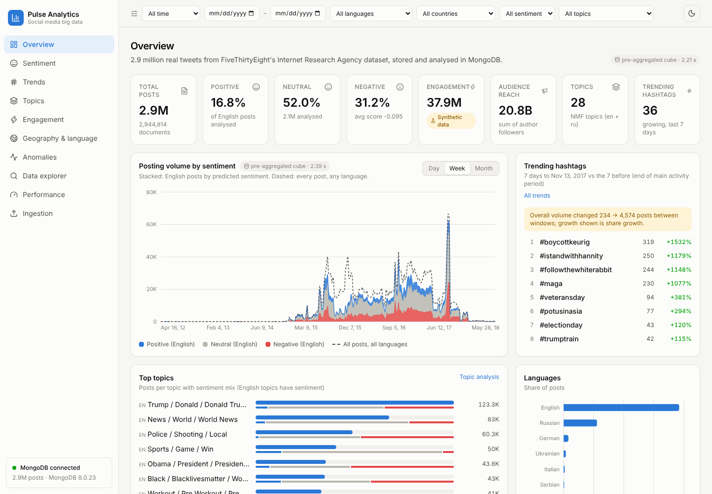

# Large-Scale Social Media Sentiment and Trend Analytics Using MongoDB

A university Big Data Analytics project. It loads **2,944,814 real tweets** into MongoDB, cleans them, adds
sentiment, topics and keywords with lightweight NLP, pre-aggregates them with MongoDB aggregation pipelines,
serves the results through a FastAPI REST API, and shows them in a React dashboard. Performance experiments
measure ingestion, indexing, aggregation and NLP at 100K, 500K, 1M and 2.95M documents.

The core platform runs on one machine with 16 GB of RAM and no GPU: data is processed in batches by Python and
MongoDB. A **Big Data Lab** extension adds the distributed side: an Apache Spark pipeline that builds a
bronze / silver / gold Parquet data lake, and a 3-shard MongoDB cluster that compares shard keys. Its results,
architecture and course concepts (5 Vs, CAP, Hadoop mapping) are shown in tabs on the dashboard's Big Data Lab
page; see [docs/bigdata.md](docs/bigdata.md).



More screenshots (sentiment, trends, topics, anomalies, explorer, performance, dark mode) are in [docs/images](docs/images/).

## What is in it

| Part | What it does | Where |
| --- | --- | --- |
| Ingestion | Streams CSV / JSON / JSONL (optionally gzipped), validates, normalises, cleans text, extracts hashtags / mentions / URLs / emoji, de-duplicates, bulk-inserts in batches, records statistics | `backend/app/ingestion/`, `scripts/ingest.py` |
| MongoDB | `posts` collection with `$jsonSchema` validation, 12 purpose-built indexes, 5 rollup collections built by aggregation pipelines | `backend/app/database/`, `backend/app/analytics/rollups.py` |
| NLP | Sentiment (TF-IDF + logistic regression, evaluated on TweetEval), topics (TF-IDF + NMF, English and Russian), per-post keywords | `backend/app/nlp/`, `scripts/train_*.py` |
| Analytics | Sentiment, topics, trends (window-over-window growth and trend score), engagement, time patterns, geography, language, anomalies (rolling z-score, IQR, Isolation Forest) | `backend/app/analytics/` |
| API | 26 FastAPI endpoints with validation, filtering, pagination and caching | `backend/app/api/`, [docs/api.md](docs/api.md) |
| Dashboard | React 19 + Vite + Tailwind + Recharts: 11 pages (including About dataset), global filters in the URL, loading / error / empty states, dark mode, phone layout | `frontend/` |
| Experiments | Ingestion scaling, batch size, worker count, index timing, indexed vs collection scan with `explain()`, aggregation scaling, rollup vs live, NLP throughput | `experiments/`, [docs/performance.md](docs/performance.md) |
| Spark data lake | PySpark 4.2 pipeline: raw CSV → bronze Parquet → silver (cleaned, de-duplicated, partitioned by year/month) → gold aggregates; scaling, codec and query-layout benchmarks | `bigdata/spark/`, [docs/bigdata.md](docs/bigdata.md) |
| Sharded MongoDB | Config server + 3 shards + `mongos` in Docker Compose; hashed vs ranged shard key: load rate, distribution, targeted vs scatter-gather queries | `bigdata/sharding/`, `docker-compose.bigdata.yml` |
| Big Data Lab page | Tabs for architecture flow, Spark, data lake, gold data, sharding, and course concepts (5 Vs, CAP, Hadoop map) | `frontend/src/pages/BigDataLab.jsx`, `frontend/src/pages/bigdata/` |
| Tests | 40 backend tests (unit + MongoDB integration + API), frontend unit tests | `backend/tests/`, `frontend/src/test/` |

## The data, honestly

* **Posts are real.** FiveThirtyEight's [russian-troll-tweets](https://github.com/fivethirtyeight/russian-troll-tweets)
  dataset: tweets from accounts that Twitter identified as linked to the Internet Research Agency, collected by
  Linvill and Warren at Clemson University, published under CC BY 4.0. 2,946,207 rows were read; 2,944,814 were
  stored after removing 1,392 duplicate tweet ids and 1 empty tweet. Dates run from 2012 to 2018.
* **It is not a sample of ordinary Twitter users.** Every account is a state-linked troll account, so the
  results describe that campaign, not public opinion.
* **Engagement is synthetic.** The dataset has no like, reply or retweet counts. To exercise the engagement
  module, `scripts/synthesize_engagement.py` generates them from each author's real follower count. Every such
  value is stored with `engagement.synthetic = true` and every engagement chart in the dashboard carries a
  *Synthetic data* badge. Do not draw conclusions about real audiences from them.
* **Sentiment is a model prediction, English only.** The classifier was trained and evaluated on TweetEval
  (test macro-F1 0.58, see [docs/performance.md](docs/performance.md)). It has not been evaluated on the IRA
  tweets themselves, which carry no sentiment labels. Non-English posts are counted as `not_analyzed`.
* **Location** is the account-level `region` field from the source (country only), known for 80.6% of posts.

Details: [docs/dataset.md](docs/dataset.md).

## Quick start (Windows, macOS or Linux)

Requirements: Python 3.11+ (built and tested with 3.13), Node.js 20+, MongoDB 7 or 8 Community Server, about
10 GB of free disk for the full dataset with indexes and rollups.

### 1. MongoDB

Install [MongoDB Community Server](https://www.mongodb.com/try/download/community) and keep the default service
running on `localhost:27017`, **or** start it with Docker:

```bash
docker compose up -d mongo
```

### 2. Backend

```bash
cd backend
python -m venv .venv
.venv\Scripts\activate            # macOS / Linux: source .venv/bin/activate
pip install -r requirements-dev.txt
copy ..\.env.example ..\.env      # macOS / Linux: cp ../.env.example ../.env
```

### 3. Data and models (run from `backend/`, about 30-60 minutes in total)

```bash
python ../scripts/download_data.py                       # ~1 GB of CSV into data/raw/
python ../scripts/ingest.py ../data/raw/ira538 --profile ira538 --source ira538 --workers 4
python ../scripts/train_sentiment.py                     # trains + evaluates on TweetEval
python ../scripts/train_topics.py                        # NMF topics for en and ru
python ../scripts/run_nlp.py --workers 4                 # sentiment, topic, keywords for every post
python ../scripts/synthesize_engagement.py               # SYNTHETIC engagement, flagged as such
python ../scripts/build_rollups.py                       # daily/hourly cubes, hashtag/keyword/user rollups
```

To try things quickly first, add `--limit 200000` to `ingest.py`.

### 4. Run

```bash
uvicorn app.main:app --reload            # in backend/, API on http://127.0.0.1:8000 (docs at /docs)
cd ../frontend && npm install && npm run dev   # dashboard on http://localhost:5173
```

After the first `npm install`, `scripts/dev.ps1` (Windows) or `scripts/dev.sh` (macOS / Linux) starts both.

### 5. Tests, lint and experiments

```bash
cd backend && python -m pytest            # needs MongoDB; uses a throwaway database social_analytics_test
ruff check app tests ../scripts ../experiments
cd ../frontend && npm test && npm run lint && npm run build

cd ../backend
set BENCH_MACHINE_LABEL=My laptop        # PowerShell: $env:BENCH_MACHINE_LABEL="My laptop"
python ../experiments/run_experiments.py all
python ../experiments/make_report.py     # regenerates docs/performance.md from the measured JSON
```

### 6. Big Data Lab (optional)

Needs Docker Desktop (it provides Java for Spark and the MongoDB cluster) and the raw CSV files in `data/raw/`.
Measured results are already in `experiments/results/`, so the dashboard page works without running this.

```powershell
.\scripts\bigdata.ps1            # Windows: builds the Spark image, runs the lake pipeline, benchmarks and the sharding experiment
./scripts/bigdata.sh             # macOS / Linux
```

Or step by step: `docker compose -f docker-compose.bigdata.yml --profile tools run --rm spark python -m bigdata.spark.pipeline`.
The built lake (gold tables and results) is attached to the GitHub release `lake-v1`.

## Repository layout

```
backend/
  app/
    api/          FastAPI routers (analytics, posts, ingestion, performance)
    analytics/    query planner (cube vs live), page queries, trends, anomalies, rollup pipelines
    database/     connection, $jsonSchema validator, index definitions with reasons
    ingestion/    readers, cleaning, normalisation, batch pipeline
    nlp/          sentiment, topics, enrichment job
    services/     TTL cache, background ingestion jobs
    schemas/      Pydantic response / request models
  tests/          pytest suite
  models/         trained models (git-ignored; created by scripts/train_*.py)
bigdata/
  spark/          lake.py (bronze/silver/gold), pipeline.py, benchmarks.py
  sharding/       cluster.py (initiate, shard, status), experiment.py, local_cluster.sh
  docker/         Spark image (Python 3.13 + Java 21 + PySpark)
frontend/         React dashboard (Vite, Tailwind v4, Recharts)
scripts/          command-line entry points (download, ingest, train, enrich, rollups, bigdata, package_lake)
experiments/      run_experiments.py, make_report.py, results/*.json (measured)
docs/             architecture, database, analytics, methodology, performance, api, dataset, report material
data/             raw/ processed/ sample/ (contents git-ignored)
```

## Documentation

* [Architecture](docs/architecture.md)
* [Database design, indexes and pipelines](docs/database.md)
* [Analytics](docs/analytics.md)
* [Methodology (NLP, trends, anomalies, synthetic engagement)](docs/methodology.md)
* [Performance experiments (generated from measured results)](docs/performance.md)
* [API reference](docs/api.md)
* [Dataset](docs/dataset.md)
* [Big Data Lab: Spark, data lake, sharding, 5 Vs, CAP](docs/bigdata.md)
* University material: [report](docs/report.md), [presentation](docs/presentation.md), [viva questions](docs/viva.md)
* Submission files: [project report (PDF)](docs/submission/BDA-Analytics-Report.pdf), [project report (Word)](docs/submission/BDA-Analytics-Report.docx), [slides (PowerPoint)](docs/submission/BDA-Analytics-Presentation.pptx)

## What this project does not do

* No multi-server deployment: the dashboard uses one `mongod`. Spark runs in local mode and the sharded cluster's
  shards share one machine with one member per replica set, so the Big Data Lab shows distribution and routing,
  not fault tolerance or the throughput of separate servers.
* No real-time streaming: data arrives through batch ingestion jobs (CLI or upload in the dashboard).
* No 5M-document experiment: the real dataset has 2.95M posts and it was not padded with synthetic posts.
* No transformer models: sentiment and topics use scikit-learn so everything runs on a CPU.

## Security

Credentials live in `.env` (git-ignored); `.env.example` lists the settings. The API never returns connection
details. Uploads are size-limited, type-checked and stored under `data/uploads/`; ingestion jobs only accept
paths inside `data/`.